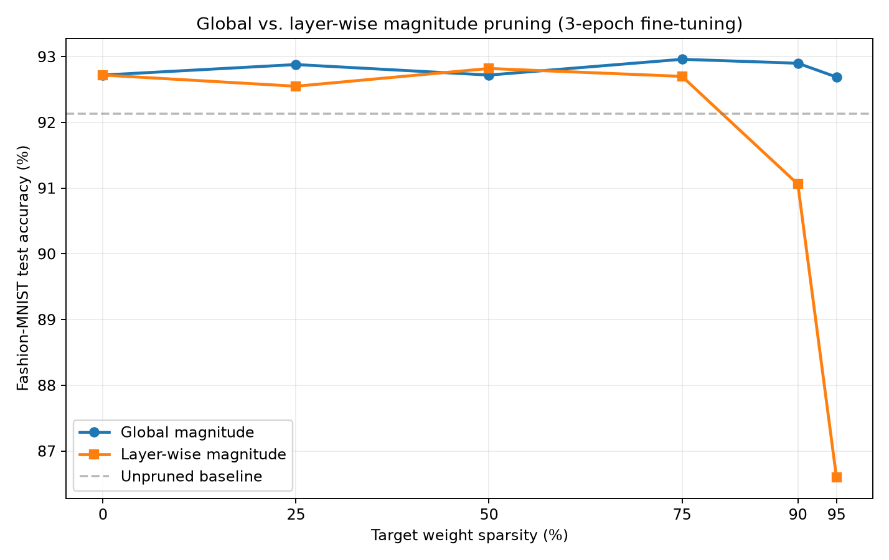
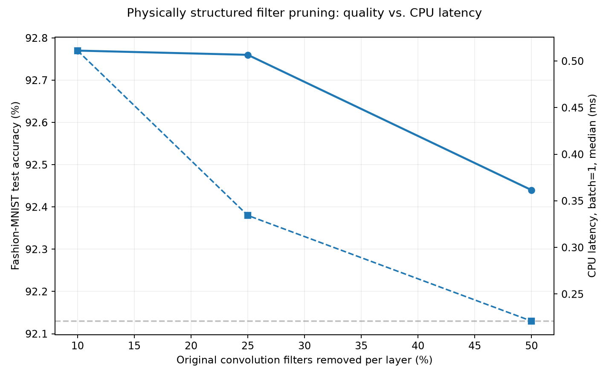
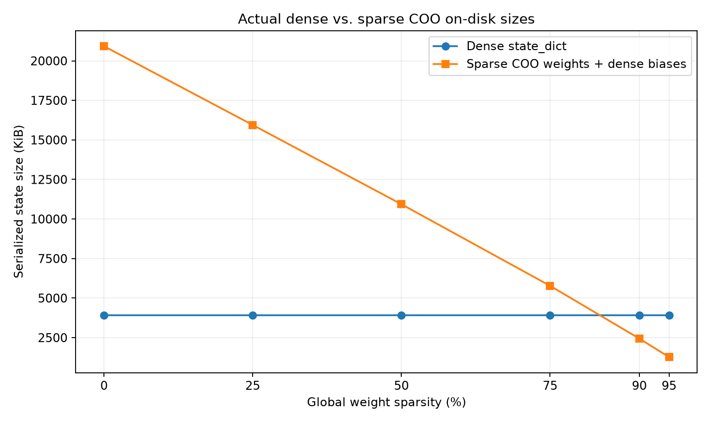
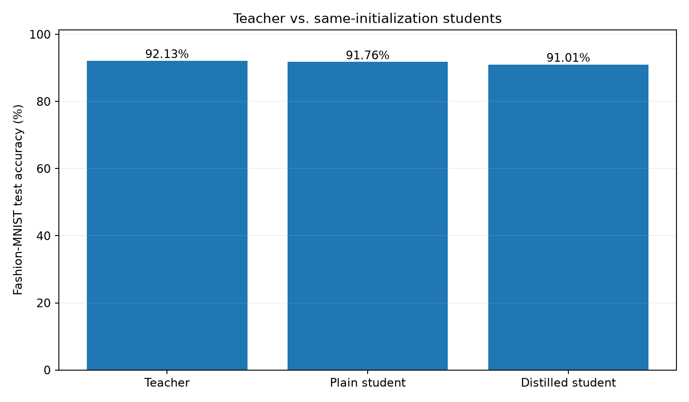

# Machine Learning - Lab 7: Compression, Pruning and Distillation

**Experiment status:** FULL DATASET RUN

> All numerical results below were computed by this script; no placeholder results are used. If a training/test subset was requested, this report MUST NOT be described as a full-data result.

## 1. Experiment setup and baseline [15 points]

- Dataset: torchvision Fashion-MNIST; **60,000 training** and **10,000 test** images; 28x28 grayscale, 10 classes. Inputs converted to tensors and normalized to [-1, 1].
- Python/PyTorch: 3.14.3 / 2.15.0+cpu; OS: Windows-11-10.0.26200-SP0.
- Training device: cpu; **CPU** inference latency device for all comparisons; CPU threads: 4; fixed batch=1; warm-up=10, measured repeats=100.
- Seed: 42; train batch size: 128; optimizer: AdamW (weight decay=1e-4). No test-set training or augmentation.
- Epochs: teacher=5, fixed-mask/structured fine-tuning=3, each student=8. Baseline/student LR=0.001; pruning fine-tune LR=0.0005.
- Teacher architecture: Conv(1->32, 3x3), Conv(32->64, 3x3), max-pool, Conv(64->128, 3x3), max-pool, Linear(6272->144), Linear(144->10), ReLU between layers.
- Student architecture: Conv(1->16), Conv(16->32), max-pool, Conv(32->48), max-pool, Linear(2352->34), Linear(34->10); same 3x3 kernels.
- Teacher: **997,434** parameters, accuracy **92.13%**, dense state **3.808 MiB**, CPU latency **1.799 ms median / 2.085 ms p95**.

## 2. Magnitude and structured pruning [35 points]

Absolute weights were ranked; the smallest were zeroed either (i) across all convolution and linear weight tensors together (global) or (ii) independently within each tensor (layer-wise). Biases were not pruned. Targets were 0%, 25%, 50%, 75%, 90%, 95%. Each pruned copy of the *same original teacher checkpoint* was fine-tuned for **3 epochs** with fixed masks: gradients at pruned indices were zeroed and masks were re-applied after every optimizer step.

Structured pruning ranked **convolution output filters by L2 norm**, removed 10%, 25%, or 50% from each convolution, and **physically rebuilt narrower convolutions and the first classifier layer** with the surviving channel indices. These three derived models were also fine-tuned for 3 epochs.

## 3. Real CPU latency vs. dense/sparse storage [15 points]

Each reported latency is based on 10 warm-up forward passes and 100 independent wall-clock forward-pass measurements on the CPU with 4 threads; **median and p95** are reported. Measurements use dense PyTorch modules with 32-bit floats at batch size 1. Latency is hardware-/workload-specific: it is not a guaranteed device speedup. The code does not label the theoretical nonzero-MAC count as measured execution.

Dense storage uses `torch.save(state_dict)`; sparse storage uses `torch.save(state_dict with weight tensors converted to coalesced COO)`. COO stores nonzero values **plus indices**: at modest sparsity it can occupy more disk space than a dense checkpoint. Full zero-filled dense tensors keep their original shapes and generally run through the **same dense CPU kernels**, so unstructured pruning rarely reduces CPU latency without a specialized sparse runtime or algorithm. Structured pruning physically changes tensor shapes, so it may reduce dense MACs and measured latency.

## 4. Knowledge distillation [30 points]

The original oversized teacher was frozen. Plain and distilled students both use the **same architecture, initial weights, train order and number of epochs**. Plain student: cross-entropy only. Distilled student: `0.5 * CE(student, label) + 0.5 * 4^2 * KL(p_student(T=4) || p_teacher(T=4))`. The KL **direction exactly follows the provided lab manual**, though KL(teacher || student) is common elsewhere. Teacher logits are detached.

- Plain student: 91.76% accuracy, 99,024 parameters, 0.381 MiB dense, 0.207 ms CPU median.
- Distilled student: 91.01% accuracy, 99,024 parameters, 0.381 MiB dense, 0.222 ms CPU median.
- Distillation minus plain accuracy: **-0.75 percentage points**. A positive change indicates an improvement under these training settings; a negative change must be reported rather than hidden.

## 5. Chapter 9 efficiency pillars [20 points]

**Energy measurements:** No wattmeter, power telemetry, or energy meter was used. Actual energy per inference (J) is therefore **not measured**, not fabricated. The table provides dense-MAC percentage relative to the teacher ONLY as a workload/energy *proxy*, not a power-consumption estimate. Latency and MAC counts are only imperfect compute/energy *proxies*; frequency, memory traffic, and device power also matter.

| Model / experiment | Data pillar | Model pillar: test accuracy; parameters; dense/COO MiB | Compute pillar: CPU median/p95 ms; dense/ideal nonzero MMAC | Energy pillar |
|:--|:--|:--|:--|:--|
| Baseline teacher | 60,000 train / 10,000 test | 92.13%; 997,434; 3.808 / 20.434 | 1.799 / 2.085; 30.03 / 30.03 | Not measured (J); dense-MAC proxy 100.0% of teacher |
| global 0% | 60,000 train / 10,000 test | 92.72%; 997,434; 3.808 / 20.434 | 1.612 / 2.085; 30.03 / 30.03 | Not measured (J); dense-MAC proxy 100.0% of teacher |
| global 25% | 60,000 train / 10,000 test | 92.88%; 997,434; 3.808 / 15.572 | 0.551 / 0.821; 30.03 / 27.72 | Not measured (J); dense-MAC proxy 100.0% of teacher |
| global 50% | 60,000 train / 10,000 test | 92.72%; 997,434; 3.808 / 10.679 | 0.602 / 1.206; 30.03 / 24.80 | Not measured (J); dense-MAC proxy 100.0% of teacher |
| global 75% | 60,000 train / 10,000 test | 92.96%; 997,434; 3.808 / 5.641 | 0.851 / 1.319; 30.03 / 19.09 | Not measured (J); dense-MAC proxy 100.0% of teacher |
| global 90% | 60,000 train / 10,000 test | 92.90%; 997,434; 3.808 / 2.384 | 0.506 / 0.987; 30.03 / 10.84 | Not measured (J); dense-MAC proxy 100.0% of teacher |
| global 95% | 60,000 train / 10,000 test | 92.69%; 997,434; 3.808 / 1.241 | 0.743 / 1.128; 30.03 / 6.77 | Not measured (J); dense-MAC proxy 100.0% of teacher |
| layerwise 0% | 60,000 train / 10,000 test | 92.72%; 997,434; 3.808 / 20.434 | 0.855 / 1.169; 30.03 / 30.03 | Not measured (J); dense-MAC proxy 100.0% of teacher |
| layerwise 25% | 60,000 train / 10,000 test | 92.55%; 997,434; 3.808 / 15.327 | 0.783 / 1.175; 30.03 / 22.52 | Not measured (J); dense-MAC proxy 100.0% of teacher |
| layerwise 50% | 60,000 train / 10,000 test | 92.82%; 997,434; 3.808 / 10.220 | 0.484 / 0.774; 30.03 / 15.02 | Not measured (J); dense-MAC proxy 100.0% of teacher |
| layerwise 75% | 60,000 train / 10,000 test | 92.70%; 997,434; 3.808 / 5.113 | 1.447 / 1.896; 30.03 / 7.51 | Not measured (J); dense-MAC proxy 100.0% of teacher |
| layerwise 90% | 60,000 train / 10,000 test | 91.06%; 997,434; 3.808 / 2.049 | 1.670 / 2.173; 30.03 / 3.00 | Not measured (J); dense-MAC proxy 100.0% of teacher |
| layerwise 95% | 60,000 train / 10,000 test | 86.60%; 997,434; 3.808 / 1.027 | 0.857 / 1.028; 30.03 / 1.50 | Not measured (J); dense-MAC proxy 100.0% of teacher |
| Structured filters 10% | 60,000 train / 10,000 test | 92.77%; 888,665; 3.393 / 18.100 | 0.511 / 0.758; 24.65 / 24.65 | Not measured (J); dense-MAC proxy 82.1% of teacher |
| Structured filters 25% | 60,000 train / 10,000 test | 92.76%; 731,194; 2.793 / 14.740 | 0.334 / 0.497; 17.11 / 17.11 | Not measured (J); dense-MAC proxy 57.0% of teacher |
| Structured filters 50% | 60,000 train / 10,000 test | 92.44%; 476,474; 1.821 / 9.442 | 0.221 / 0.321; 7.79 / 7.79 | Not measured (J); dense-MAC proxy 25.9% of teacher |
| Plain student | 60,000 train / 10,000 test | 91.76%; 99,024; 0.381 / 2.174 | 0.207 / 0.283; 6.52 / 6.52 | Not measured (J); dense-MAC proxy 21.7% of teacher |
| Distilled student | 60,000 train / 10,000 test | 91.01%; 99,024; 0.381 / 2.174 | 0.222 / 0.331; 6.52 / 6.52 | Not measured (J); dense-MAC proxy 21.7% of teacher |

`dense/ideal nonzero MMAC` describes dense arithmetic and an **optimistic zero-skipping lower bound**. It is not a claim about actual PyTorch CPU operation counts.

## 6. Conclusion

The teacher reached **92.13%** test accuracy with **997,434** parameters. The distilled student uses **9.93%** of its parameters and shows a CPU latency ratio (teacher/student) of **8.10x** on the measured setup. With exactly the same student architecture and training budget, distillation changed accuracy by **-0.75 percentage points** compared with training without a teacher. Structured filter removal can shrink actual dense layers, whereas global/layer-wise zero masks alone do not. COO may or may not reduce disk size depending on how many indices must be stored. No direct inference energy measurement is available; making a Joules/inference claim would require hardware power telemetry.

### Measurement and interpretation cautions

- Model size means serialized **weight state**, not the Python runtime, source code or deployment package.
- Test-set accuracy is the fraction of correct Fashion-MNIST predictions; the test set is never used for optimization.
- Repeat CPU benchmarks on the **target hardware** before drawing mobile/MCU latency conclusions.
- `metrics.csv` contains every exact experiment row, including target and *measured* weight sparsity.

## References

1. Course manual, *Lab 7: Compression: pruning and distillation*, page 9.
2. Vijay Janapa Reddi, *Introduction to Machine Learning Systems*, Ch. 9, Ch. 10 ss. 10.3-10.4 (assigned course reading).
3. Xiao, Rasul and Vollgraf, *Fashion-MNIST: a Novel Image Dataset for Benchmarking Machine Learning Algorithms*, 2017, arXiv:1708.07747.
